# Meshtastic Bridge

`meshtastic_bridge` is a ROS 2 package that shares ROS 2 topics between devices over a [Meshtastic](https://meshtastic.org/) LoRa mesh. Each device runs one node, `meshtastic_bridge_node`, next to its existing ROS 2 system. The bridge finds local topics by itself and needs no code changes or custom message types:

- **Transmit:** the bridge scans the ROS graph and subscribes to every topic that passes a configurable include/exclude list. It sends the latest message of each topic into the mesh at a rate limit you configure.
- **Receive:** messages from other devices are published locally under the sending device's name with their original message type. For example, `/gps/fix` on `drone1` shows up as `/mesh/drone1/gps/fix` on every other device.

Every device runs the same node. A device that only reports, such as an autonomous drone that never needs data from the rest of the fleet, sets `rx_enabled: false` and only transmits.

> **Status:** draft. The node shows the intended structure and data flow, and still has open `TODO`s. See [Development Status](#development-status).

## How It Works

```mermaid
flowchart RL
    subgraph DRONE["Device: drone1"]
        direction TB
        subgraph DRONE_ROS["ROS 2 · Raspberry Pi"]
            direction TB
            D_GPS("/gps/fix")
            D_BAT("/battery_state")
            D_BRIDGE["<b>meshtastic_bridge_node</b><br/>scan + filter topics"]
        end
        D_RADIO["<b>LILYGO T3S3 ESP32-S3</b><br/>LR1121 · Meshtastic firmware<br/>mesh routing + encryption"]
        D_ANT{{"Antenna<br/>6 dBi omni"}}
    end

    subgraph MESH["The Fleet Mesh"]
        direction TB
        RELAY["<b>Relay node</b><br/>standalone T3S3"]
        OTHERS["Other drones / robots"]
    end

    subgraph BASE["Device: base"]
        direction TB
        B_ANT{{"Antenna<br/>6 dBi omni"}}
        B_RADIO["<b>LILYGO T3S3 ESP32-S3</b><br/>LR1121 · Meshtastic firmware<br/>mesh routing + encryption"]
        subgraph BASE_ROS["ROS 2"]
            direction TB
            B_BRIDGE["<b>meshtastic_bridge_node</b><br/>republish by device"]
            B_GPS("/mesh/drone1/gps/fix")
            B_BAT("/mesh/drone1/battery_state")
            B_LQ("/mesh/link_quality")
        end
    end

    D_GPS --> D_BRIDGE
    D_BAT --> D_BRIDGE
    D_BRIDGE -- "protobuf over serial<br/>USB-C · /dev/ttyACM0" --> D_RADIO
    D_RADIO -- "50 Ω SMA" --- D_ANT
    D_ANT -. "LoRa 868/915 MHz<br/>direct" .-> B_ANT
    D_ANT -.-> RELAY
    RELAY -. "relayed<br/>(hops > 0)" .-> B_ANT
    RELAY -.- OTHERS
    B_ANT -- "50 Ω SMA" --- B_RADIO
    B_RADIO -- "protobuf over serial<br/>USB-C · /dev/ttyACM0" --> B_BRIDGE
    B_BRIDGE --> B_GPS
    B_BRIDGE --> B_BAT
    B_BRIDGE --> B_LQ

    %% Colours come from the viewer's default Mermaid theme so the diagram
    %% works in light and dark mode. Only borders and links are styled.
    classDef mesh stroke-dasharray:6 4
    class MESH,OTHERS mesh

    linkStyle 2,9 stroke:#3b82f6,stroke-width:2px
    linkStyle 3,8 stroke:#8b5cf6,stroke-width:2px
```



Topics from other devices appear under `/<remote_namespace>/<device>/` (`remote_namespace` is `mesh` in the default config). The bridge on `base` sends its own topics the same way; the diagram shows one direction only.

Messages travel in their CDR-serialized form, the same bytes ROS 2 uses on its own wire, so any message type works. A small header carries a 16-bit topic id. Each device announces its topic ids together with topic name, type and device name when it starts bridging a topic, every `announce_period_s`, and whenever another device asks for them. Messages larger than one LoRa packet (~228 bytes of data) are split into up to `max_fragments` fragments. See [`codec.py`](meshtastic_bridge/codec.py) for the wire format.

LoRa carries a few hundred bytes per second at best, and every device shares the same channel. So the bridge never forwards a stream as-is. For each topic it keeps only the latest message and sends at most one per `min_interval_s`. Bridge low-rate status and telemetry, not control loops or sensor streams.

## Hardware Requirements

Per device:

- Raspberry Pi 4 (or another Linux host running ROS 2). Relay-only nodes can run standalone without a host.
- LILYGO T3S3 v1.x ESP32-S3 with an LR1121 LoRa module, flashed with **Meshtastic** firmware (see [Firmware](#firmware))
- 868/915 MHz omnidirectional antenna with an SMA connector (6 dBi)

> Never power on the LoRa board without an antenna attached. Transmitting without one can damage the radio.

The Pi connects to the T3S3 over USB-C, which carries both power and data. The board usually shows up as `/dev/ttyACM0`, and the bridge finds it automatically (`serial_port: auto`). A board with Wi-Fi enabled can also be reached over TCP (`tcp_host`).

## Installation

Clone the repository into the `src/` folder of a ROS 2 workspace:

```sh
mkdir -p ~/fleet_ws/src
cd ~/fleet_ws/src
git clone <repository-url> meshtastic_bridge
```

The package targets ROS 2 Humble on Ubuntu 22.04. Run the same ROS 2 distro on every device: CDR layouts are only guaranteed to match within a distro.

## Dependencies

ROS dependencies resolve through rosdep:

```sh
cd ~/fleet_ws
rosdep install --from-paths src --ignore-src -y
```

The [`meshtastic`](https://pypi.org/project/meshtastic/) Python package is not available through rosdep or apt. Install it manually (version 2.3 or newer):

```sh
pip install meshtastic
```

A receiving device can only republish a topic if its message package is installed. If a type is missing, the bridge logs a warning and skips that topic.

## Firmware

The bridge talks to the radio through Meshtastic's serial/TCP API, so every board must run **Meshtastic firmware**.

> **LilyGo's factory image does not work.** `t3s3-v1.x-all-band-lr1121-factory_20250425_0x0.bin`, from the [LilyGo-LoRa-Series firmware folder](https://github.com/Xinyuan-LilyGO/LilyGo-LoRa-Series/tree/master/firmware), is LilyGo's *factory test firmware for hardware validation*, which is what the boards ship with. It does not implement the Meshtastic API, so the bridge can't use a board running it. It's still useful for checking that a new board's radio and display work before you flash Meshtastic.
>
> Don't confuse it with Meshtastic's own `firmware-tlora-t3s3-v1-<version>.factory.bin`. "Factory" there just means a complete image written at address `0x0`, and that is the file you want.

Meshtastic supports the T3S3 v1.x with LR1121 under the target **`tlora-t3s3-v1`** ([device docs](https://meshtastic.org/docs/hardware/devices/lilygo/lora/)). Flash it in one of two ways:

- **Web flasher:** open [flasher.meshtastic.org](https://flasher.meshtastic.org/) in Chrome or Edge, pick device **"Tlora T3s3 V1"** and a stable release, and tick *Full Erase and Install* (needed when replacing the LilyGo image).
- **Command line:** download `firmware-esp32s3-<version>.zip` from [Meshtastic releases](https://github.com/meshtastic/firmware/releases), then run:
  ```sh
  esptool.py --chip esp32s3 --port /dev/ttyACM0 erase_flash
  esptool.py --chip esp32s3 --port /dev/ttyACM0 --baud 921600 \
      write_flash 0x0 firmware-tlora-t3s3-v1-<version>.factory.bin
  ```
  Check the release notes in case the file layout has changed.

If the board isn't detected or flashing fails, put it in download mode: hold **BOOT**, press and release **RST**, then release **BOOT**. Press **RST** again after flashing. If the screen stays black after flashing, Meshtastic's docs suggest the CLI install script instead.

Then give every board the same region, modem preset and channel. A freshly flashed board has region `UNSET` and won't transmit until you set one:

```sh
meshtastic --port /dev/ttyACM0 --set lora.region EU_868
meshtastic --port /dev/ttyACM0 --set lora.modem_preset LONG_FAST
meshtastic --port /dev/ttyACM0 --info
```

The LR1121 also supports 2.4 GHz (`LORA_24` region), but the 868/915 MHz antennas in the parts list only suit the sub-GHz regions.

When the bridge connects, it logs the board's hardware model (expected `TLORA_T3_S3`), firmware version, LoRa region and modem preset. It logs an error if the region is `UNSET`, if transmit is disabled, or if the firmware is older than `min_firmware_version`. A board that opens the port but never answers is almost certainly not running Meshtastic.

## Running the Bridge

> **One device per ROS domain.** If several devices share a network, give each its own `ROS_DOMAIN_ID` (or set `ROS_LOCALHOST_ONLY=1`). Otherwise their ROS graphs merge, and each bridge also sees, and sends, the other devices' local topics. The bridge never re-sends topics under a known remote device name, but a separate domain per device is the reliable fix.

Build and source the package:

```sh
cd ~/fleet_ws
colcon build --packages-select meshtastic_bridge
source install/setup.bash
```

Start the bridge next to your existing nodes:

```sh
ros2 launch meshtastic_bridge bridge.launch.py device_name:=rover1
```

A transmit-only device:

```sh
ros2 launch meshtastic_bridge bridge.launch.py device_name:=drone1 rx_enabled:=false
```

Choose topics, rates and other settings in [`config/meshtastic_bridge_node.yaml`](config/meshtastic_bridge_node.yaml), or pass your own file with `config:=/path/to/file.yaml`. The `serial_port`, `device_name`, `tx_enabled` and `rx_enabled` launch arguments override the values in the config file.

### Parameters

| Parameter | Default | Description |
|---|---|---|
| `serial_port` | `auto` | Serial device of the board. `auto` picks the single Meshtastic-capable port |
| `tcp_host` | `""` | IP/hostname of a board with Wi-Fi enabled. Takes precedence over `serial_port` |
| `connect_timeout_s` | `30` | How long to wait for the device on connect (needs meshtastic Python ≥ 2.5) |
| `expected_hw_model` | `TLORA_T3_S3` | Warn if the board reports another model. `""` disables the check |
| `min_firmware_version` | `""` | Log an error if the firmware is older, e.g. `"2.5.0"`. `""` disables the check |
| `device_name` | `""` | Name other devices see this one under. Empty uses the Meshtastic node id (`node_a1b2c3d4`) |
| `tx_enabled` | `true` | Send local topics into the mesh |
| `rx_enabled` | `true` | Publish topics received from other devices. `false` = transmit only |
| `include_topics` | `["*"]` | Glob patterns for topics to bridge |
| `exclude_topics` | `["/rosout", "/parameter_events", "/mesh/*", "/tf", "/tf_static"]` | Glob patterns for topics never to bridge. These win over `include_topics` |
| `allow_devices` | `["*"]` | Only accept data from devices matching these patterns (node id `!a1b2c3d4` or device name) |
| `block_devices` | unset | Never accept data from these devices. Wins over `allow_devices` |
| `rx_include_topics` | `["*"]` | Only republish received topics matching these patterns (name on the sending device) |
| `rx_exclude_topics` | unset | Never republish these received topics |
| `min_interval_s` | `10.0` | Minimum time between two messages of the same topic |
| `topic_intervals` | `["/gps/fix=5.0", "/battery_state=60.0"]` | Per-topic intervals as `"pattern=seconds"`. The first match wins |
| `max_fragments` | `4` | Messages that need more LoRa packets than this are not sent |
| `scan_period_s` | `5.0` | How often the ROS graph is scanned for new topics |
| `announce_period_s` | `300.0` | How often topic announcements are repeated |
| `remote_namespace` | `""` | Optional prefix for received topics: `/<remote_namespace>/<device>/<topic>` |
| `link_quality_topic` | `/mesh/link_quality` | Link quality of each received message |
| `dest` | `^all` | Meshtastic destination. `^all` broadcasts to the mesh |
| `channel_index` | `0` | Meshtastic channel |
| `hop_limit` | `0` | Max relay hops. `0` uses the firmware default |
| `port_num` | `PRIVATE_APP` | Meshtastic port number used by the bridge |
| `max_payload_bytes` | `233` | LoRa payload size per packet |

### Topics

| Topic | Type | Contents |
|---|---|---|
| `/<device>/<topic>` | same as the original | Messages received from `<device>` (only when `rx_enabled`) |
| `/mesh/link_quality` | `diagnostic_msgs/DiagnosticStatus` | One message per received message. `name` is the device; `values` hold `topic`, `source_topic`, `msg_seq`, `rssi`, `snr` and `hops` |

`hops` is the number of relays a message passed through (`0` = direct).

## Link Tests

The remote (moving) device runs **one node that never changes**: `echo_device`. Every test runs on the host against it, so moving to a new position only means walking there and starting the next test on the host.

The tests only publish and subscribe to ordinary ROS topics under `/link_test/`, and the bridges carry them, so they test the whole path. Every launch file starts the bridge with [`config/bridge_test.yaml`](config/bridge_test.yaml), which bridges only the test topics and turns off rate limiting. Pass `start_bridge:=false` to use a bridge that is already running.

```sh
# Remote / moving device: start once, leave running
scripts/run_test.sh echo

# Host: run tests as often as needed
scripts/run_test.sh latency    label:=500m
scripts/run_test.sh throughput label:=500m payload_size:=200 interval_s:=2.0
```

| Topic (on the host) | Type | Direction | Purpose |
|---|---|---|---|
| `/link_test/ping` → `/<echo>/link_test/pong` | `std_msgs/Header` | host → echo → host | Latency: the echo device republishes every ping |
| `/link_test/data` | `std_msgs/UInt8MultiArray` | host → echo | Throughput: the echo device counts what arrives |
| `/link_test/report_request` → `/<echo>/link_test/report` | `std_msgs/String` | host → echo → host | Throughput: the echo device's counts (JSON) for one run |

Every host test starts with a handshake: unnumbered pings every 2 s until the echo device answers (`handshake_timeout_s`, default 120 s). This waits until both bridges have discovered each other's topics, so start-up losses don't count against the measurement.

### Range measurements

Range isn't a separate test. Move the echo device to each position and run the latency and/or throughput test there with a `label` (distance, "relay", etc.). Each result records the link quality the bridge reported: RSSI, SNR and hop count (`0` = direct, more = relayed). To compare direct and relayed links, repeat a position with a third board in between as a relay. The relay can be a standalone board running stock Meshtastic firmware.

### Latency

Round-trip time through both bridges and the mesh, as an application sees it. All timing uses the host's clock, so the clocks don't need to be synced.

```sh
scripts/run_test.sh latency label:=500m count:=50 interval_s:=5.0
```

`payload_size:=N` pads the ping, to show how message size affects latency. Link quality columns describe the echo → host direction (measured on each pong).

### Throughput

Delivered data rate for a given message size and publish interval. The host sends `count` messages, then asks the echo device how many arrived. The request repeats until the report gets through (`report_timeout_s`). The bridge keeps only the latest message per topic, so anything published faster than the radio can send is overwritten and counts as lost.

```sh
scripts/run_test.sh throughput label:=500m payload_size:=200 interval_s:=2.0
scripts/sweep_throughput.sh 30 label:=500m          # grid of sizes and intervals
```

Link quality columns describe the host → echo direction (measured by the echo device). Short intervals intentionally overload the channel. Keep within the EU868 duty-cycle limit.

### Results

All results go to `~/fleet_test_results/`:

| File | Contents |
|---|---|
| `latency_summary.csv` | One row per latency run: label, sent/answered, RTT median/p95/max, RSSI, SNR, hops |
| `latency_<label>_<time>.csv` | One row per ping of a run, with RSSI/SNR/hops |
| `throughput_summary.csv` | One row per throughput run: label, size, interval, offered load, delivered, goodput, RSSI, SNR, hops |

```sh
python3 scripts/analyze_results.py          # tables grouped by label
```

### Emulated device

A stand-in for a real robot. Use it to try the include/exclude filters and transmit-only mode, or to see the fleet traffic end to end:

```sh
scripts/run_test.sh device device_name:=rover1
scripts/run_test.sh device device_name:=drone1 rx_enabled:=false
```

## Package Layout

```
meshtastic_bridge/
├── config/
│   ├── meshtastic_bridge_node.yaml      # default bridge settings
│   └── bridge_test.yaml      # bridge settings for the link tests
├── meshtastic_bridge/
│   ├── meshtastic_bridge_node.py        # the bridge
│   └── codec.py              # wire format and fragment reassembly
├── scripts/
│   ├── launch/               # bridge.launch.py and one launch file per test node
│   ├── tests/                # echo_device (remote), latency/throughput tests (host), emulated_device
│   ├── run_test.sh
│   ├── sweep_throughput.sh
│   └── analyze_results.py
└── test/                     # ament linters (flake8, pep257, copyright)
```

`colcon test --packages-select meshtastic_bridge` runs only the linters in `test/`. The link tests need hardware and run through the launch files.

## Troubleshooting

1. **`Could not connect to a Meshtastic device on ...`**
   - If the port opens but the connection **times out**, the board is not running Meshtastic firmware. It's probably still on LilyGo's factory test image. See [Firmware](#firmware).
   - Check that the board shows up: `ls /dev/ttyACM* /dev/ttyUSB*`, or `sudo dmesg | tail`.
   - Add yourself to the `dialout` group, then log out and back in:
     ```sh
     sudo usermod -a -G dialout $USER
     ```
   - Only one process can hold the port. Close the `meshtastic` CLI and any serial monitor first.

2. **`No Meshtastic device found` / `Several possible devices found`**
   - Auto-detect needs exactly one candidate port. If several USB serial devices are connected, set `serial_port` explicitly.

3. **`LoRa region is UNSET`**
   - Set the region: `meshtastic --set lora.region EU_868`. Until then, the firmware won't transmit.

4. **A local topic is not bridged**
   - Check the startup log for `Bridging <topic>`. If the line is missing, the topic doesn't match `include_topics`, or it matches `exclude_topics`.
   - `Not sending <topic>: ... fragments`: the message is too large. Raise `max_fragments`, or bridge a smaller topic.

5. **Nothing arrives from another device**
   - Check that all boards share the same region, modem preset and channel (`meshtastic --info`).
   - `Filtered out <topic> from <device>`: the device or topic is excluded by `allow_devices`, `block_devices`, `rx_include_topics` or `rx_exclude_topics`.
   - Check that the receiver has `rx_enabled: true` and the sender has `tx_enabled: true`.
   - The first messages from a new device may be dropped until its announcement arrives. The receiver asks for the announcement automatically.
   - `Cannot republish ...: type ... is not installed`: install that message package on the receiver.

## Development Status

Open items in the draft (search the code for `TODO`):

- Reconnect automatically after the serial link drops
- Unsubscribe from topics that disappear
- Optional Meshtastic ACKs for selected topics
- Handle two devices that announce the same `device_name`
- Join range tx/rx logs for delivery ratio per distance, and plot the results

## License

MIT. See [LICENSE.md](LICENSE.md).
