```mermaid
flowchart RL
    subgraph DRONE["Device: drone1"]
        direction TB
        subgraph DRONE_ROS["ROS 2 · Raspberry Pi"]
            direction TB
            D_GPS("/gps/fix")
            D_BAT("/battery_state")
            D_BRIDGE["<b>meshtastic_bridge_node</b><br/>scan + filter topics"]
        end
        D_RADIO["<b>LILYGO T3S3 ESP32-S3</b><br/>LR1121 · Meshtastic firmware<br/>mesh routing + encryption"]
        D_ANT{{"Antenna<br/>6 dBi omni"}}
    end

    subgraph MESH["The Fleet Mesh"]
        direction TB
        RELAY["<b>Relay node</b><br/>standalone T3S3"]
        OTHERS["Other drones / robots"]
    end

    subgraph BASE["Device: base"]
        direction TB
        B_ANT{{"Antenna<br/>6 dBi omni"}}
        B_RADIO["<b>LILYGO T3S3 ESP32-S3</b><br/>LR1121 · Meshtastic firmware<br/>mesh routing + encryption"]
        subgraph BASE_ROS["ROS 2"]
            direction TB
            B_BRIDGE["<b>meshtastic_bridge_node</b><br/>republish by device"]
            B_GPS("/mesh/drone1/gps/fix")
            B_BAT("/mesh/drone1/battery_state")
            B_LQ("/mesh/link_quality")
        end
    end

    D_GPS --> D_BRIDGE
    D_BAT --> D_BRIDGE
    D_BRIDGE -- "protobuf over serial<br/>USB-C · /dev/ttyACM0" --> D_RADIO
    D_RADIO -- "50 Ω SMA" --- D_ANT
    D_ANT -. "LoRa 868/915 MHz<br/>direct" .-> B_ANT
    D_ANT -.-> RELAY
    RELAY -. "relayed<br/>(hops > 0)" .-> B_ANT
    RELAY -.- OTHERS
    B_ANT -- "50 Ω SMA" --- B_RADIO
    B_RADIO -- "protobuf over serial<br/>USB-C · /dev/ttyACM0" --> B_BRIDGE
    B_BRIDGE --> B_GPS
    B_BRIDGE --> B_BAT
    B_BRIDGE --> B_LQ

    %% Colours come from the viewer's default Mermaid theme so the diagram
    %% works in light and dark mode. Only borders and links are styled.
    classDef mesh stroke-dasharray:6 4
    class MESH,OTHERS mesh

    linkStyle 2,9 stroke:#3b82f6,stroke-width:2px
    linkStyle 3,8 stroke:#8b5cf6,stroke-width:2px
```

# Meshtastic Bridge

`meshtastic_bridge` is a ROS 2 package that shares ROS 2 topics between devices over a [Meshtastic](https://meshtastic.org/) LoRa mesh. Each device runs one node, `meshtastic_bridge_node`, next to its existing ROS 2 system. The bridge picks up local topics automatically and sends them into the mesh. Topics from other devices appear locally as `/mesh/<device>/<topic>`, e.g. `/mesh/drone1/gps/fix`.

This README covers how to set the package up and use it. For the design, every parameter, the duty-cycle budget and how the tests work, see [`meshtastic_bridge/README.md`](meshtastic_bridge/README.md).

> **Status:** draft. See [development status](meshtastic_bridge/README.md#development-status).

## How it works

Each device runs one node, `meshtastic_bridge_node`, next to its existing ROS 2 system:

- **Transmit:** every `scan_period_s`, the bridge scans the ROS graph and subscribes to each topic that matches `include_topics` and none of `exclude_topics`. It sends the latest message of each topic into the mesh, rate limited per topic.
- **Receive:** messages from other devices are published locally with their original message type, under `/<remote_namespace>/<device_name>/<topic>`. Link quality for every received message goes to `link_quality_topic`.

Every device runs the same node. `rx_enabled: false` makes a device transmit only (e.g. an autonomous drone that never needs fleet data), and `tx_enabled: false` makes it listen only.



The bridge on `base` sends its own topics the same way; the diagram shows one direction only.

## What you need

Per device:

- Raspberry Pi 4 (or another Linux host) with ROS 2 Humble
- LILYGO T3S3 v1.x ESP32-S3 with an LR1121 LoRa module
- 868/915 MHz omnidirectional antenna with an SMA connector

> Never power on the LoRa board without an antenna attached. Transmitting without one can damage the radio.

Connect the board to the Pi over USB-C. A board that only relays can run standalone, without a Pi.

## 1. Install

```sh
mkdir -p ~/fleet_ws/src
cd ~/fleet_ws/src
git clone <repository-url> meshtastic_bridge
cd ~/fleet_ws
rosdep install --from-paths src --ignore-src -y
pip install meshtastic
colcon build --packages-select meshtastic_bridge
source install/setup.bash
```

Use the same ROS 2 distro on every device.

## 2. Flash Meshtastic onto the board

The board must run **Meshtastic** firmware. LilyGo's factory image (`t3s3-v1.x-all-band-lr1121-factory_..._0x0.bin`) does not work ([why](meshtastic_bridge/README.md#firmware-regions-and-presets)).

**Web flasher (easiest):** open [flasher.meshtastic.org](https://flasher.meshtastic.org/) in Chrome or Edge, pick **"Tlora T3s3 V1"** and a stable release, and tick *Full Erase and Install*.

**Command line:** download `firmware-esp32s3-<version>.zip` from [Meshtastic releases](https://github.com/meshtastic/firmware/releases), then run:

```sh
esptool.py --chip esp32s3 --port /dev/ttyACM0 erase_flash
esptool.py --chip esp32s3 --port /dev/ttyACM0 --baud 921600 \
    write_flash 0x0 firmware-tlora-t3s3-v1-<version>.factory.bin
```

If the board isn't detected, put it in download mode: hold **BOOT**, press and release **RST**, then release **BOOT**. Press **RST** again after flashing.

## 3. Set region and preset

Every board needs the same region and modem preset. A freshly flashed board won't transmit until a region is set:

```sh
meshtastic --port /dev/ttyACM0 --set lora.region EU_868
meshtastic --port /dev/ttyACM0 --set lora.modem_preset LONG_FAST
meshtastic --port /dev/ttyACM0 --info      # shows the node id, e.g. !a1b2c3d4
```

Or set `lora_region` and `modem_preset` in the bridge config, and the bridge applies them when it connects. For more throughput at shorter range, use `SHORT_FAST` (region `EU_868`), or `NARROW_FAST` (region `EU_N_868`, firmware 2.8+).

## 4. Run the bridge

If several devices share a network, give each one its own `ROS_DOMAIN_ID` first.

```sh
# Normal device: sends its topics and receives everyone else's
ros2 launch meshtastic_bridge bridge.launch.py device_name:=rover1

# Transmit-only device, e.g. an autonomous drone
ros2 launch meshtastic_bridge bridge.launch.py device_name:=drone1 rx_enabled:=false

# Your own settings
ros2 launch meshtastic_bridge bridge.launch.py config:=/path/to/my_bridge.yaml
```

Copy [`config/meshtastic_bridge_node.yaml`](config/meshtastic_bridge_node.yaml) to make your own config. Common changes:

```yaml
meshtastic_bridge_node:
  ros__parameters:
    include_topics: ["/gps/fix", "/battery_state", "/status"]   # what to send
    topic_intervals: ["/gps/fix=30.0"]                          # how often (seconds)
    block_devices: ["test_*"]                                    # ignore these senders
    dest: "!a1b2c3d4"                                            # send to one node only
```

Keep send intervals long. In the EU, each device may only transmit 10% of the time ([budget](meshtastic_bridge/README.md#rate-limiting-and-duty-cycle-eu868)).

Check that it works:

```sh
ros2 topic list | grep /mesh/                # topics from other devices
ros2 topic echo /mesh/link_quality           # RSSI / SNR / hops per message
```

## 5. Run the link tests

Start the echo device on the remote (moving) device once, then run tests from the host as often as needed:

```sh
# Remote device: start once, leave running
scripts/run_test.sh echo

# Host
scripts/run_test.sh latency    label:=500m
scripts/run_test.sh throughput label:=500m payload_size:=200 interval_s:=2.0
scripts/sweep_throughput.sh 30 label:=500m          # several sizes and intervals

# Show results
python3 scripts/analyze_results.py
```

To measure range, move the remote device to each position and run the tests there with a new `label`. RSSI, SNR and hop count are recorded automatically. Results are written to `~/fleet_test_results/`.

Long test series run into the 10% duty cycle and then stop transmitting. Give `sweep_throughput.sh` a longer pause, e.g. `PAUSE_S=600 scripts/sweep_throughput.sh ...`.

## Troubleshooting

| Symptom | Fix |
|---|---|
| `Could not connect ...` and the connection **times out** | The board isn't running Meshtastic. Flash it ([step 2](#2-flash-meshtastic-onto-the-board)) |
| `Could not connect ...` / permission denied | `sudo usermod -a -G dialout $USER`, then log out and in. Close the `meshtastic` CLI and serial monitors |
| `No Meshtastic device found` / `Several possible devices found` | Plug the board in, or set `serial_port` (e.g. `/dev/ttyACM0`) |
| `LoRa region is UNSET` | `meshtastic --set lora.region EU_868` ([step 3](#3-set-region-and-preset)) |
| A local topic is not sent | Check the log for `Bridging <topic>`. Adjust `include_topics` / `exclude_topics`. For `... fragments`, the message is too large: raise `max_fragments` |
| Nothing arrives from another device | All boards need the same region, preset and channel. Check `rx_enabled` / `tx_enabled` and the receive filters (`Filtered out ...` in the log). The first messages after start-up may be dropped |
| `Cannot republish ...: type ... is not installed` | Install that message package on the receiving device |
| Tests suddenly lose everything | The duty-cycle budget is used up. Wait, or use a faster preset |

## License

MIT. See [LICENSE.md](LICENSE.md).
