# Meshtastic Bridge: Design and Reference

Background, configuration reference and design notes for `meshtastic_bridge`. For installation and day-to-day use, see the [main README](../README.md).

- [How it works](#how-it-works)
- [Wire format](#wire-format)
- [Rate limiting and duty cycle](#rate-limiting-and-duty-cycle-eu868)
- [Firmware, regions and presets](#firmware-regions-and-presets)
- [Parameters](#parameters)
- [Topics](#topics)
- [Multiple devices on one network](#multiple-devices-on-one-network)
- [Link test design](#link-test-design)
- [Package layout](#package-layout)
- [Development status](#development-status)

## How it works

Each device runs one node, `meshtastic_bridge_node`, next to its existing ROS 2 system:

- **Transmit:** every `scan_period_s`, the bridge scans the ROS graph and subscribes to each topic that matches `include_topics` and none of `exclude_topics`. It sends the latest message of each topic into the mesh, rate limited per topic.
- **Receive:** messages from other devices are published locally with their original message type, under `/<remote_namespace>/<device_name>/<topic>`. Link quality for every received message goes to `link_quality_topic`.

Every device runs the same node. `rx_enabled: false` makes a device transmit only (e.g. an autonomous drone that never needs fleet data), and `tx_enabled: false` makes it listen only.

```mermaid
flowchart RL
    subgraph DRONE["Device: drone1"]
        direction TB
        subgraph DRONE_ROS["ROS 2 · Raspberry Pi"]
            direction TB
            D_GPS("/gps/fix")
            D_BAT("/battery_state")
            D_BRIDGE["<b>meshtastic_bridge_node</b><br/>scan + filter topics"]
        end
        D_RADIO["<b>LILYGO T3S3 ESP32-S3</b><br/>LR1121 · Meshtastic firmware<br/>mesh routing + encryption"]
        D_ANT{{"Antenna<br/>6 dBi omni"}}
    end

    subgraph MESH["The Fleet Mesh"]
        direction TB
        RELAY["<b>Relay node</b><br/>standalone T3S3"]
        OTHERS["Other drones / robots"]
    end

    subgraph BASE["Device: base"]
        direction TB
        B_ANT{{"Antenna<br/>6 dBi omni"}}
        B_RADIO["<b>LILYGO T3S3 ESP32-S3</b><br/>LR1121 · Meshtastic firmware<br/>mesh routing + encryption"]
        subgraph BASE_ROS["ROS 2"]
            direction TB
            B_BRIDGE["<b>meshtastic_bridge_node</b><br/>republish by device"]
            B_GPS("/mesh/drone1/gps/fix")
            B_BAT("/mesh/drone1/battery_state")
            B_LQ("/mesh/link_quality")
        end
    end

    D_GPS --> D_BRIDGE
    D_BAT --> D_BRIDGE
    D_BRIDGE -- "protobuf over serial<br/>USB-C · /dev/ttyACM0" --> D_RADIO
    D_RADIO -- "50 Ω SMA" --- D_ANT
    D_ANT -. "LoRa 868/915 MHz<br/>direct" .-> B_ANT
    D_ANT -.-> RELAY
    RELAY -. "relayed<br/>(hops > 0)" .-> B_ANT
    RELAY -.- OTHERS
    B_ANT -- "50 Ω SMA" --- B_RADIO
    B_RADIO -- "protobuf over serial<br/>USB-C · /dev/ttyACM0" --> B_BRIDGE
    B_BRIDGE --> B_GPS
    B_BRIDGE --> B_BAT
    B_BRIDGE --> B_LQ

    %% Colours come from the viewer's default Mermaid theme so the diagram
    %% works in light and dark mode. Only borders and links are styled.
    classDef mesh stroke-dasharray:6 4
    class MESH,OTHERS mesh

    linkStyle 2,9 stroke:#3b82f6,stroke-width:2px
    linkStyle 3,8 stroke:#8b5cf6,stroke-width:2px
```



The bridge on `base` sends its own topics the same way; the diagram shows one direction only.

**Loop protection.** The bridge never sends back out topics it publishes itself, or topics under a known remote device name.

**Receive filters.** `allow_devices` and `block_devices` match a sender's Meshtastic node id (`!a1b2c3d4`) or its announced device name, and the block list wins. Until a device has announced its name, only the block list is checked, so the announcement can still arrive. `rx_include_topics` and `rx_exclude_topics` match the topic name on the sending device. A filtered topic is remembered without a publisher, so its data is dropped without asking the sender to announce it again.

**Destination.** `dest: "^all"` broadcasts. A node id such as `dest: "!a1b2c3d4"` (quoted in YAML, because a leading `!` starts a YAML tag) unicasts every bridged topic to that one node. Other boards may relay the packets but don't deliver them to their own bridge. Announce requests always go straight back to the device that triggered them.

## Wire format

Messages travel in their CDR-serialized form, the same bytes ROS 2 uses on its own wire, so any message type works without per-type code. The bridge sends on Meshtastic port `PRIVATE_APP`. Each packet starts with one byte that holds the protocol version (high nibble) and the packet kind (low nibble). See [`codec.py`](codec.py).

| Kind | Contents | Sent |
|---|---|---|
| `ANNOUNCE` | 16-bit topic id, device name, topic name, message type | When a topic is first bridged, every `announce_period_s`, and on request |
| `DATA` | Topic id, message seq, fragment index/count, CDR chunk | For each message |
| `REQUEST` | — | When `DATA` arrives for an unknown topic id. Asks the sender to re-announce |

The topic id is a CRC of `topic|type`. Messages larger than one packet (228 B of data after the 5 B header) are split into up to `max_fragments` fragments (maximum 16) and reassembled on the receiving side. Incomplete messages are dropped after 60 s.

Both ends need the message type installed and should run the same ROS 2 distro: the CDR layout of a type is only guaranteed to match within one distro. The package targets ROS 2 Humble. Newer distros should work but are untested; Foxy and Galactic lack APIs the code uses.

## Rate limiting and duty cycle (EU868)

LoRa carries very little data, and every device shares the same channel. So the bridge never forwards a stream as-is. For each topic it keeps only the latest message and sends at most one per interval (`min_interval_s`, or the first matching `topic_intervals` entry). Messages that arrive faster are overwritten.

Meshtastic's `EU_868` region transmits in the 869.4–869.65 MHz sub-band. Each device may transmit there **at most 10% of the time**, i.e. 360 s per rolling hour, at up to 27 dBm. The firmware enforces this itself: once the budget is used up, the device **stops transmitting** until the rolling hour frees up airtime ([Meshtastic LoRa config](https://meshtastic.org/docs/configuration/radio/lora/); sub-band table in [this EU868 guide](https://edgepilot.io/news/lorawan-frequency-bands-europe-eu868-guide)).

Approximate airtime per message, and what 10% allows if a device sends nothing else:

| Preset | 40 B payload | 120 B | 233 B (max) | Sustained data at 10%, 233 B messages |
|---|---|---|---|---|
| `LONG_FAST` (default, SF11 / 250 kHz) | 0.72 s | 1.30 s | 2.16 s | ~167 msg/h ≈ 11 B/s |
| `MEDIUM_FAST` (SF9 / 250 kHz) | 0.20 s | 0.39 s | 0.64 s | ~560 msg/h ≈ 36 B/s |
| `SHORT_FAST` (SF7 / 250 kHz) | 0.06 s | 0.12 s | 0.20 s | ~1770 msg/h ≈ 114 B/s |
| `NARROW_FAST` (SF7 / 62.5 kHz, CR 4/6, region `EU_N_868`) | 0.29 s | 0.57 s | 0.97 s | ~370 msg/h ≈ 24 B/s |

These numbers come from the standard LoRa time-on-air formula with a 16-symbol preamble and ~22 B of Meshtastic overhead per packet. Treat them as estimates.

Size the bridge settings so that, on each device, the sum over all bridged topics of *airtime ÷ interval* stays below 0.10. For example, `NavSatFix` (~115 B, ~1.3 s on `LONG_FAST`) every 30 s uses 4.3%. A relay spends its own budget on every packet it forwards. Faster presets buy more messages at the cost of range.

## Firmware, regions and presets

**Meshtastic firmware is required.** The bridge talks to the radio through Meshtastic's serial/TCP API. LilyGo's factory image (`t3s3-v1.x-all-band-lr1121-factory_20250425_0x0.bin`, from the [LilyGo-LoRa-Series firmware folder](https://github.com/Xinyuan-LilyGO/LilyGo-LoRa-Series/tree/master/firmware)) is *factory test firmware for hardware validation*. It doesn't implement that API, so a board running it opens the serial port but never answers, and the bridge times out. Meshtastic's own `firmware-tlora-t3s3-v1-<version>.factory.bin` is a different thing: "factory" there just means a complete image written at address `0x0`. Meshtastic supports the T3S3 v1.x with LR1121 under the target `tlora-t3s3-v1` ([device docs](https://meshtastic.org/docs/hardware/devices/lilygo/lora/)).

**Checks on connect.** The bridge logs the board's hardware model (expected `TLORA_T3_S3`), firmware version, LoRa region and modem preset. It logs an error if:
- the region is `UNSET` (the firmware won't transmit),
- transmit is disabled,
- or the firmware is older than `min_firmware_version`.

**Applying radio settings.** If `lora_region` or `modem_preset` is set and differs from the board's setting, the bridge writes the LoRa config to the board. The board then reboots, and the bridge waits `reboot_wait_s` and reconnects. Region and preset must match on **every** device.

**Presets:**
- **`LONG_FAST`:** the default.
- **`SHORT_FAST`:** SF7, 250 kHz. More throughput at shorter range. Works in the normal `EU_868` region.
- **`NARROW_FAST`:** SF7, 62.5 kHz, CR 4/6. Only available in region **`EU_N_868`**, which uses the same 869.4–869.65 MHz sub-band and 10% duty cycle. It needs recent firmware (2.8+ according to third-party sources, so check the release notes) and a `meshtastic` Python package new enough to know the preset name. A board on `EU_868` doesn't hear one on `EU_N_868`.

**2.4 GHz.** The LR1121 also supports 2.4 GHz (`LORA_24` region), but it can only use one band at a time, and the 868/915 MHz antennas in the parts list only suit the sub-GHz regions.

## Parameters

Defaults as in [`config/meshtastic_bridge_node.yaml`](../config/meshtastic_bridge_node.yaml). The `serial_port`, `device_name`, `tx_enabled` and `rx_enabled` launch arguments of `bridge.launch.py` override the values in the config file.

| Parameter | Default | Description |
|---|---|---|
| `serial_port` | `auto` | Serial device of the board. `auto` picks the single Meshtastic-capable port |
| `tcp_host` | `""` | IP/hostname of a board with Wi-Fi enabled. Takes precedence over `serial_port` |
| `connect_timeout_s` | `30` | How long to wait for the device on connect (needs meshtastic Python ≥ 2.5) |
| `expected_hw_model` | `TLORA_T3_S3` | Warn if the board reports another model. `""` disables the check |
| `min_firmware_version` | `""` | Log an error if the firmware is older, e.g. `"2.5.0"`. `""` disables the check |
| `lora_region` | `""` | Write this LoRa region to the device on connect, e.g. `EU_868` or `EU_N_868`. `""` leaves the device as configured |
| `modem_preset` | `""` | Write this modem preset on connect, e.g. `LONG_FAST`, `SHORT_FAST`, `NARROW_FAST`. `""` leaves the device as configured |
| `reboot_wait_s` | `20.0` | Wait after writing LoRa settings (the device reboots) before reconnecting |
| `device_name` | `""` | Name other devices see this one under. Empty uses the Meshtastic node id (`node_a1b2c3d4`) |
| `tx_enabled` | `true` | Send local topics into the mesh |
| `rx_enabled` | `true` | Publish topics received from other devices. `false` = transmit only |
| `include_topics` | `["*"]` | Glob patterns for topics to bridge |
| `exclude_topics` | `["/rosout", "/parameter_events", "/mesh/*", "/tf", "/tf_static"]` | Glob patterns for topics never to bridge. These win over `include_topics` |
| `allow_devices` | `["*"]` | Only accept data from devices matching these patterns (node id `!a1b2c3d4` or device name) |
| `block_devices` | unset | Never accept data from these devices. Wins over `allow_devices` |
| `rx_include_topics` | `["*"]` | Only republish received topics matching these patterns (name on the sending device) |
| `rx_exclude_topics` | unset | Never republish these received topics |
| `min_interval_s` | `60.0` | Minimum time between two messages of the same topic. See [duty cycle](#rate-limiting-and-duty-cycle-eu868) |
| `topic_intervals` | `["/gps/fix=30.0", "/battery_state=120.0"]` | Per-topic intervals as `"pattern=seconds"`. The first match wins |
| `max_fragments` | `4` | Messages that need more LoRa packets than this are not sent |
| `scan_period_s` | `5.0` | How often the ROS graph is scanned for new topics |
| `announce_period_s` | `300.0` | How often topic announcements are repeated |
| `remote_namespace` | `mesh` | Prefix for received topics: `/<remote_namespace>/<device>/<topic>` |
| `link_quality_topic` | `/mesh/link_quality` | Link quality of each received message |
| `dest` | `^all` | Meshtastic destination. `^all` broadcasts; a node id (`"!a1b2c3d4"`) unicasts |
| `channel_index` | `0` | Meshtastic channel |
| `hop_limit` | `0` | Max relay hops. `0` uses the firmware default |
| `port_num` | `PRIVATE_APP` | Meshtastic port number used by the bridge |
| `max_payload_bytes` | `233` | LoRa payload size per packet |
| `poll_hz` | `20.0` | How often received packets are processed and due messages sent |

## Topics

| Topic | Type | Contents |
|---|---|---|
| `/<remote_namespace>/<device>/<topic>` | same as the original | Messages received from `<device>` (only when `rx_enabled`) |
| `/mesh/link_quality` | `diagnostic_msgs/DiagnosticStatus` | One message per received message. `name` is the device; `values` hold `topic`, `source_topic`, `msg_seq`, `rssi`, `snr` and `hops` |

`hops` is the number of relays a message passed through (`0` = direct).

## Multiple devices on one network

If several devices share a network, give each its own `ROS_DOMAIN_ID` (or set `ROS_LOCALHOST_ONLY=1`). Otherwise their ROS graphs merge, and each bridge also sees, and sends, the other devices' local topics. The bridge never re-sends topics under a known remote device name, but a separate domain per device is the reliable fix. This also applies when testing two bridges on one computer.

## Link test design

The tests are ROS nodes in `scripts/tests/` that only publish and subscribe to ordinary topics under `/link_test/`. The bridges carry those topics, so the tests cover the whole path. The launch files start the bridge with [`config/bridge_test.yaml`](../config/bridge_test.yaml), which bridges only the test topics and turns off rate limiting.

- **`echo_device.py`** runs permanently on the remote device. It answers every test type, so nothing has to be restarted there between tests.
- **`latency_test.py` and `throughput_test.py`** run on the host, one at a time, against the echo device.

| Topic (on the host) | Type | Direction | Purpose |
|---|---|---|---|
| `/link_test/ping` → `/<echo>/link_test/pong` | `std_msgs/Header` | host → echo → host | Latency: the echo device republishes every ping |
| `/link_test/data` | `std_msgs/UInt8MultiArray` | host → echo | Throughput: the echo device counts what arrives (header: run id, seq, count) |
| `/link_test/report_request` → `/<echo>/link_test/report` | `std_msgs/String` | host → echo → host | Throughput: the echo device's counts (JSON) for one run |

**Handshake.** Every host test first sends unnumbered pings every 2 s until the echo device answers (`handshake_timeout_s`, default 120 s). That gives both bridges time to discover each other's topics, so start-up losses don't count against the measurement.

**Latency.** RTT is measured on the host's clock, so the devices' clocks don't need to be synced. Link quality is that of the pongs (echo → host).

**Throughput.** The host sends `count` messages, then repeats a report request until the echo device answers (`report_timeout_s`). Goodput is the bytes received divided by the time between the first and last message received, measured on the echo device. Link quality is measured by the echo device (host → echo). The bridge keeps only the latest message per topic, so anything published faster than the radio can send is overwritten and counts as lost.

**Range.** Range isn't a separate test. Run the latency and throughput tests at each position, with a `label`. Every result carries RSSI, SNR and hop count.

**Duty cycle during tests.** Once a device has used its 360 s per hour, the firmware stops transmitting, and the losses you then measure come from the duty-cycle limit, not from the radio link. On `LONG_FAST`, 50 messages of 200 B already use ~100 s. The echo device spends its own budget on pongs and reports.

**Result files** in `~/fleet_test_results/`:

| File | Contents |
|---|---|
| `latency_summary.csv` | One row per latency run: label, sent/answered, RTT median/p95/max, RSSI, SNR, hops |
| `latency_<label>_<time>.csv` | One row per ping of a run, with RSSI/SNR/hops |
| `throughput_summary.csv` | One row per throughput run: label, size, interval, offered load, delivered, goodput, RSSI, SNR, hops |

**Emulated device.** `emulated_device.py` is a stand-in robot. It publishes `/emulated/battery_state`, `/emulated/gps/fix` and `/emulated/status`, and logs the same topics from other devices. Use it to try the filters and transmit-only mode.

## Package layout

```
meshtastic_bridge/
├── config/
│   ├── meshtastic_bridge_node.yaml   # default bridge settings
│   └── bridge_test.yaml              # bridge settings for the link tests
├── meshtastic_bridge/
│   ├── meshtastic_bridge_node.py     # the bridge
│   ├── codec.py                      # wire format and fragment reassembly
│   └── README.md                     # this file
├── scripts/
│   ├── launch/                       # bridge.launch.py and one launch file per test node
│   ├── tests/                        # echo_device (remote), latency/throughput tests (host), emulated_device
│   ├── run_test.sh
│   ├── sweep_throughput.sh
│   └── analyze_results.py
└── test/                             # ament linters (flake8, pep257, copyright)
```

`colcon test --packages-select meshtastic_bridge` runs only the linters in `test/`. The link tests need hardware and run through the launch files.

## Development status

Draft. Open items (search the code for `TODO`):

- Reconnect automatically after the serial link drops
- Unsubscribe from topics that disappear
- Optional Meshtastic ACKs for selected topics
- Handle two devices that announce the same `device_name`
- Plot latency and throughput results against distance
